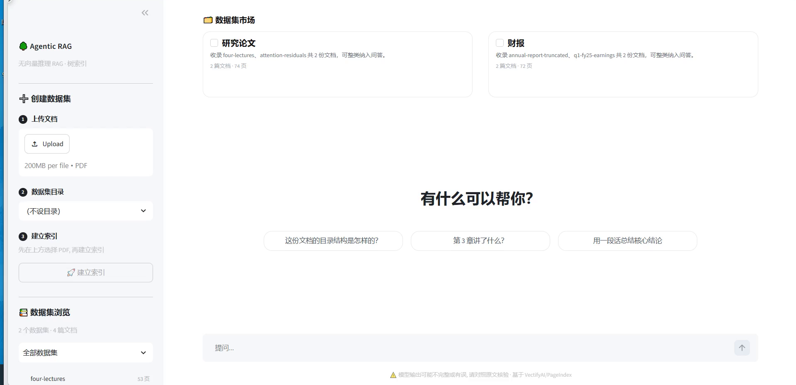

# Agentic RAG

**无向量、无切分的文档问答 Web UI**：让模型先读懂文档的树状目录，再顺着目录逐层"翻阅"，命中哪几页就把那几页原文交给模型作答。

基于 [PageIndex](https://github.com/VectifyAI/PageIndex) 的推理式检索（reasoning-based retrieval）能力，用 Streamlit 把「模型自主翻阅文档」这套 agentic 检索流程做成一上手就能用的本地知识库界面。

<p>
  
  
  
  
</p>

---



▶ **[75 秒演示视频](docs/demo.mp4)**：在「数据集市场」勾选财报数据集 → 输入问题 → 模型翻阅目录树定位页码 → 流式给出带引用的回答。演示数据为公开财报，完整过程无剪辑。

## 目录

- [三条 RAG 路线怎么选](#三条-rag-路线怎么选)
- [本项目站在哪条路上](#本项目站在哪条路上)
- [优劣势（实话实说）](#优劣势实话实说)
- [适用与不适用](#适用与不适用)
- [功能](#功能)
- [快速开始](#快速开始)
- [配置模型服务](#配置模型服务)
- [使用流程](#使用流程)
- [项目结构](#项目结构)
- [工作原理](#工作原理)
- [常见问题](#常见问题)
- [安全与隐私](#安全与隐私)

## 三条 RAG 路线怎么选

做文档问答，市面上其实只有三种范式，差别在于**「怎么找到该看哪一页」**。

| | ① 向量 RAG | ② Agentic Search（无索引） | ③ 树索引 + LLM 推理导航（本项目） |
| --- | --- | --- | --- |
| 索引产物 | 切块 + embedding + 向量库 | 无索引，文件系统即索引 | 章节树 JSON（节点 = 自然章节） |
| 检索方式 | 相似度 top-k | LLM 反复调 grep / 读文件 / 换关键词 | LLM 读目录树选节点 → 取该节点页码范围原文 |
| 典型代表 | LlamaIndex、Dify、RAGFlow | Claude Code 式 agentic search、Deep Research | [VectifyAI/PageIndex](https://github.com/VectifyAI/PageIndex) |
| 可解释性 | 命中若干片段 | 工具调用轨迹 | 命中的**章节节点 + 页码**直接高亮 |
| 中文语义泛化 | 强 | 弱（靠模型想到同义词） | 中（靠标题与摘要的语义） |
| 精确匹配（编号/专名） | 弱 | 最强 | 强（章节定位后读原文） |
| 单次查询成本 | 低（不耗 LLM token 检索） | 高（多轮 LLM + 工具） | 中（一次推理 + 少量读页） |
| 文档更新 | 需重建索引 | 立即生效 | 需重建该文档的树 |

## 本项目站在哪条路上

走的是 **③ 树索引 + LLM 推理导航**，并把这条路线做成一个能直接用的产品界面：

```
入库：PDF → 版面分析（字号/加粗/编号/间距启发式，无 LLM）→ 章节树
      → 自底向上 LLM 摘要（叶子原文 → 父节点 → … → 根）

查询：问题 + 树结构（标题 + 摘要，不含正文）→ LLM 一次推理选出相关节点
      → 按节点页码区间读原文 → 生成带页级引用的答案
```

选它的理由很简单：**向量 RAG 的痛点几乎都来自"切块"，而这条路不切块。**

## 优劣势（实话实说）

### 向量 RAG 的强项

- **语义泛化**：问「离职后义务」能命中标题写「脱密期管理」的段落，字面完全不重叠也能召回
- **快且便宜**：一次建库，之后是毫秒级检索，检索本身不消耗 LLM token
- **生态成熟**：切块策略、混合检索、重排器都有现成方案

### 向量 RAG 的局限（也是本项目的出发点）

- **切块破坏上下文**：答案跨块、跨章节时召回不全，模型只看到半句话
- **top-k 相似 ≠ 相关**：高分段落可能只是"泛泛而谈"的那一段，把真正精确的那句稀释掉
- **精确匹配弱**：编号（如 `DOC-2024-001`）、专名、密级名这类低频 token 在向量空间里几乎没有区分度，多一个空格、换一种写法就崩
- **静态索引**：文档一改就得重建，没有"查不到再查一次"的能力

### 本项目（树索引推理导航）的强项

- **结构完整**：索引对齐文档的自然章节，跨小节、跨页的问题也能拿到连续原文
- **可解释**：命中的是「第 3 章第 2 节，第 12–14 页」，不是一堆语料片段，便于人工核对
- **全局视角**：节点摘要做自底向上聚合，"这份文档的核心管控思路是什么"这类汇总题不会只抓到冰山一角
- **精确与语义兼顾**：先用标题/摘要做语义定位，再回原文，编号类问题也能落到正确页
- **无向量库运维**：索引就是一个 JSON 树 + 页面文本，删掉目录即回到空库

### 本项目的局限（用之前请先看这段）

- **建索引要花一次 LLM 成本**：每个章节节点生成一句摘要，长文档首次入库需要几十秒到几分钟
- **查询比向量检索慢**：一次推理 + 若干次读页，端到端通常是秒级到十几秒，不适合高并发、低延迟场景
- **依赖文档自身的层级质量**：扫描件、无标题的纯文本、排版混乱的文档，树会退化成"平铺 + 按页切"，效果打折
- **不适合"大海捞针"式模糊语义检索**：语料里没有明确章节归属时，向量召回的泛化能力仍然更好
- **单机单用户定位**：本地文件存储，没有多租户、权限体系与并发调度

> 结论：**结构清晰的长文档 + 需要引用出处 + 人少但问题深**，这条路优势最大；**海量碎片语料 + 高并发 + 模糊语义**，还是向量 RAG 更合适。两者并不互斥，工程上常见的做法是拿树索引做"精读层"、向量检索做"粗筛层"。

## 适用与不适用

| ✅ 适合 | ❌ 不适合 |
| --- | --- |
| 制度、规范、财报、研报、手册等有章节层级的 PDF | 无结构的聊天记录、碎片化短文本 |
| 需要给出页码/章节出处的合规、审计场景 | 毫秒级响应的在线高并发检索 |
| 单文档几十到几百页，问题需要跨章节综合 | 靠"意思相近"捞回同义表述的模糊搜索 |
| 内网/离线环境，不想维护向量数据库 | 多租户 SaaS、需要细粒度权限隔离 |

## 功能

- **三步建库**：`上传文档` → `数据集目录` → `建立索引`，全程在左侧边栏
- **数据集市场**：右侧顶部把每个目录渲染成一张卡片，勾选即切换问答范围（都不勾 = 全库问答）
- **过程可见**：章节树随模型调用实时高亮、已读取页码可展开、思考过程独立展示
- **流式可中断**：回答边生成边渲染，随时可停，已生成内容保留在会话里
- **纯本地存储**：索引落在 `.pageindex/`，上传件落在 `uploads/`，不依赖任何数据库
- **单文件应用**：全部 UI 与编排逻辑都在 `app.py`，方便按需改造

## 快速开始

要求 Python **3.11+**（CI 覆盖 3.11 / 3.12；流式输入特性依赖 Streamlit ≥1.66，而它已不再支持 3.10）。

```bash
git clone https://github.com/js2thon/agentic_rag.git
cd agentic_rag

python -m venv .venv
source .venv/bin/activate        # Windows: .venv\Scripts\activate
pip install -r requirements.txt  # 国内网络慢可加: -i https://pypi.tuna.tsinghua.edu.cn/simple

# 配置模型服务(Windows 用 copy)
cp .streamlit/secrets.toml.example .streamlit/secrets.toml
# 编辑 secrets.toml, 填入 llm_base / llm_key / llm_model
```

启动：

```bash
streamlit run app.py     # 或 python -m streamlit run app.py
./run.sh                 # Windows: run.bat（会自动找项目内 .venv）
```

打开 http://localhost:8503，左侧上传一份 PDF → 建立索引 → 在右侧提问。

> 首次启动只有空库：`.pageindex/` 和 `uploads/` 会在第一次建索引时自动创建，不需要手工准备任何数据。
> 还没填 key 也能打开界面，只是建索引和问答会提示补配置。

## 配置模型服务

任意 **OpenAI 兼容网关**都能用（官方 OpenAI、自建网关、公司内网网关均可），会请求 `{llm_base}/chat/completions`。

| 键（secrets.toml） | 环境变量 | 说明 |
| --- | --- | --- |
| `llm_base` | `LLM_BASE` | 网关地址，默认 `https://api.openai.com/v1` |
| `llm_key` | `LLM_KEY` | API Key，**必填** |
| `llm_model` | `LLM_MODEL` | 模型标识，**必填**；需支持 function calling |

优先级：`secrets.toml` > 环境变量。想先确认通不通：

```bash
python scripts/check_llm.py
```

未配置时应用仍可打开，但建索引与问答会提示补配置。

## 使用流程

1. **左侧 · 创建数据集**：上传 PDF → （可选）选一个数据集目录，或新建目录 → 点「建立索引」
2. **右侧 · 数据集市场**：勾选要问的目录；**都不勾 = 全库问答**
3. **提问**：输入框或下方示例问题；回答上方可展开章节树、命中页码与思考过程
4. **左侧 · 数据集浏览**：只读查看某目录下有哪些文档，不参与问答范围

> 数据集 = 文档的 `metadata.category` 分组。`datasets.json` 可以给每个数据集写一句人工介绍（不提供则自动生成）。

## 项目结构

```
.
├── app.py                      # Streamlit 应用(UI + 索引/问答编排)
├── pageindex/                  # 内置 PageIndex SDK 0.2.10(MIT, 见 NOTICE.md)
├── .streamlit/
│   ├── config.toml             # 主题、性能、关闭文件监听
│   └── secrets.toml.example    # 模型服务配置模板
├── datasets.example.json       # 数据集人工描述模板
├── scripts/check_llm.py        # 模型服务连通性自检
├── requirements.txt
├── pyproject.toml              # 元数据 + ruff 配置(不走打包安装)
├── run.sh / run.bat            # 一键启动
├── .github/workflows/ci.yml    # 语法检查 + 导入自检 + 启动自检
├── LICENSE                     # MIT
├── NOTICE.md                   # 内置 SDK 与第三方说明
└── README.md
```

运行时生成（均已在 `.gitignore` 中）：

```
uploads/          # 上传的 PDF
.pageindex/       # 索引库(树结构 + 页面文本 + manifest)
```

## 工作原理

1. **建索引**：`flash` 模式解析 PDF 的版面与标题层级 → 生成目录树，每个节点带一句 LLM 摘要（这一步会调一次模型）
2. **问答**：模型先拿到目录树 → 决定打开哪些章节 → 通过 `get_page_content` 取回对应页面原文 → 基于原文作答
3. **范围约束**：勾选数据集后，工具层会对 `doc_id` 做硬限制，模型只能读到范围内的文档

## 常见问题

**`pip install` 卡住 / 很慢？**
换国内镜像：`pip install -r requirements.txt -i https://pypi.tuna.tsinghua.edu.cn/simple`。依赖里 `litellm`、`openai-agents` 依赖树较大，首次安装几分钟属正常。

**提示 `streamlit: command not found`？**
用 `python -m streamlit run app.py`，不依赖脚本是否在 PATH 里。

**改完代码刷新页面没变化？**
`.streamlit/config.toml` 里关闭了文件监听（避免每次 rerun 扫描 `.venv` 上万文件）。改完代码重启进程即可。

**建立索引一直转圈／报模型不可用？**
应用在建索引前会先发一次极小的探活请求；失败时直接把网关返回的错误贴出来。先跑 `python scripts/check_llm.py` 定位是地址、Key 还是模型名的问题。

**索引数据在哪？怎么清空？**
在 `.pageindex/`（固定在项目目录下，与启动时的 cwd 无关），删掉目录即回到空库。`.pageindex/manifest.json` 记录文档名、页数与摘要。

**可以用哪些模型？**
任何支持 function calling / tool use 的模型。索引阶段的摘要生成对模型能力要求不高，问答阶段建议用强一些的模型。

**扫描件能用吗？**
可以先跑 OCR 再入库。不做 OCR 时，纯图片页没有文本层，树里只会有页码、没有内容。

## 安全与隐私

- 密钥只存在本地 `.streamlit/secrets.toml` 或环境变量，仓库仅提供模板
- 文档与索引只落本地磁盘；问答时仅**命中的页面文本**会随请求发给你配置的模型网关
- 仓库不含任何示例文档、索引或业务数据

## 参考与致谢

- [VectifyAI/PageIndex](https://github.com/VectifyAI/PageIndex)：无向量树索引与推理导航的实现与基准（其公布的 FinanceBench 结果中，推理式检索准确率显著高于传统向量 RAG）
- Anthropic《Effective context engineering for AI agents》：agentic search 与 just-in-time 上下文加载的工程视角
- 向量 RAG 侧的对照参考：LlamaIndex / Dify / RAGFlow

## 许可

MIT。内置的 PageIndex SDK 版权归 Vectify AI，详见 [NOTICE.md](NOTICE.md)。
